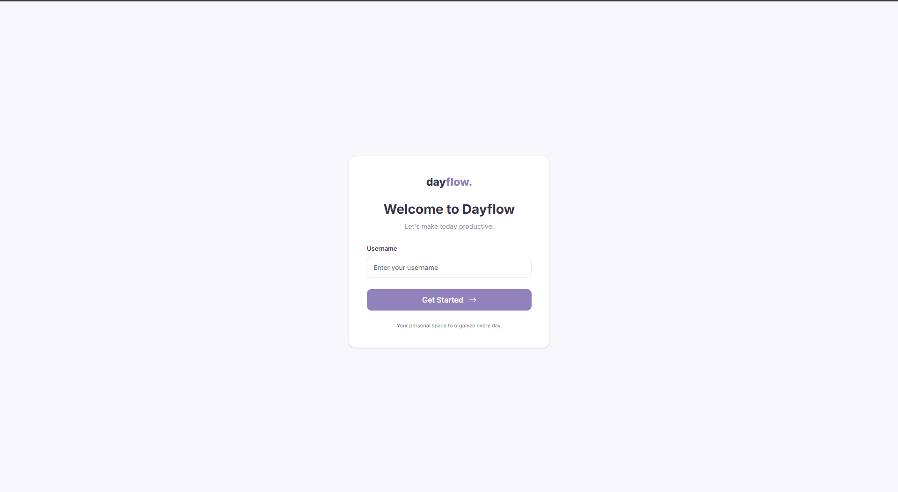
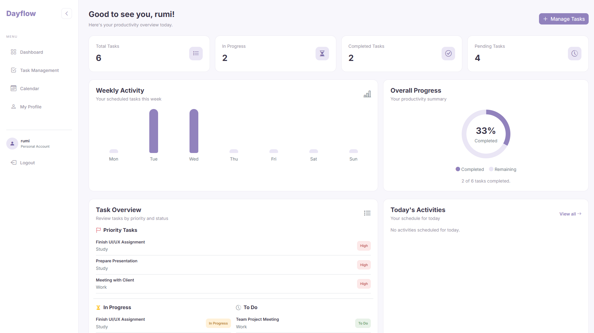
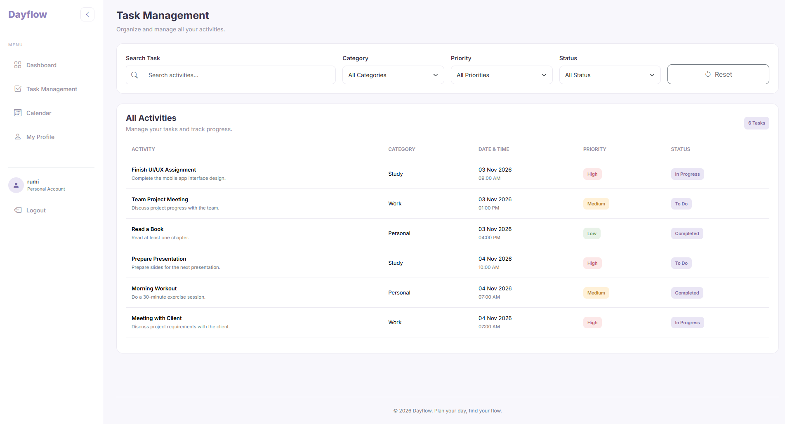
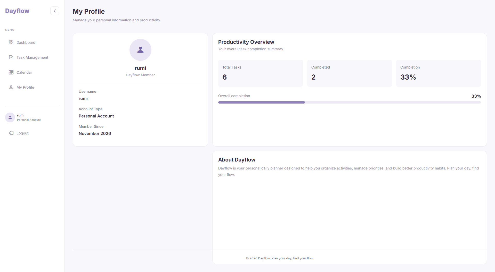

# Dayflow — Daily Planner & Productivity Dashboard

**Plan your day, find your flow.**

Dayflow adalah aplikasi web Daily Planner & Productivity Dashboard yang dirancang untuk membantu pengguna mengatur aktivitas harian, mengelola tugas, memantau progres pekerjaan, dan menyusun jadwal secara lebih terstruktur.

Aplikasi ini dikembangkan menggunakan framework Laravel dengan pendekatan Model-View-Controller (MVC), Blade Template, dan Bootstrap 5. Dayflow memiliki antarmuka yang sederhana, modern, dan responsif dengan dominasi warna lavender untuk memberikan pengalaman penggunaan yang nyaman.

---

## Preview Website

Berikut merupakan tampilan antarmuka aplikasi Dayflow.

### 1. Login Page
<!-- Simpan screenshot login dengan nama login.png di folder screenshots -->


Halaman login merupakan halaman awal bagi pengguna untuk memasukkan username sebelum mengakses dashboard Dayflow.

### 2. Dashboard
<!-- Simpan screenshot dashboard dengan nama dashboard.png di folder screenshots -->


Dashboard menampilkan ringkasan produktivitas pengguna, meliputi jumlah seluruh tugas, tugas yang sedang dikerjakan, tugas yang telah selesai, dan tugas yang masih tertunda.

Selain itu, terdapat visualisasi aktivitas mingguan, persentase penyelesaian tugas, daftar tugas prioritas, serta aktivitas yang dijadwalkan pada hari ini.

### 3. Task Management
<!-- Simpan screenshot management dengan nama management.png di folder screenshots -->


Halaman Task Management digunakan untuk melihat dan mengelola daftar aktivitas. Pengguna dapat melihat informasi tugas berdasarkan judul, kategori, tanggal, prioritas, dan status pengerjaan.

### 4. Calendar
<!-- Simpan screenshot calendar dengan nama calendar.png di folder screenshots -->


Halaman Calendar menyediakan tampilan kalender untuk membantu pengguna melihat jadwal dan aktivitas berdasarkan tanggal.

### 5. Profile
<!-- Simpan screenshot profile dengan nama profile.png di folder screenshots -->


Halaman Profile menampilkan informasi pengguna dan ringkasan produktivitas berdasarkan aktivitas yang telah dikelola.

---

## Features

Dayflow menyediakan beberapa fitur utama untuk mendukung pengelolaan aktivitas sehari-hari.

| Fitur | Deskripsi |
|---|---|
| Login | Memasukkan username untuk mengakses aplikasi. |
| Dashboard | Menampilkan ringkasan aktivitas dan produktivitas pengguna. |
| Task Management | Menampilkan dan mengelola daftar tugas. |
| Task Priority | Mengidentifikasi tugas dengan tingkat prioritas tinggi. |
| Task Status | Menampilkan status To Do, In Progress, dan Completed. |
| Weekly Activity | Menampilkan jumlah aktivitas berdasarkan hari dalam satu minggu. |
| Overall Progress | Menampilkan persentase tugas yang telah diselesaikan. |
| Calendar | Menampilkan jadwal dan aktivitas dalam bentuk kalender. |
| Profile | Menampilkan informasi dan ringkasan produktivitas pengguna. |

---

## Tech Stack

Teknologi yang digunakan dalam pengembangan Dayflow:

### Backend
- **PHP** — Bahasa pemrograman untuk mengembangkan logika aplikasi.
- **Laravel 13** — Framework PHP yang digunakan untuk membangun aplikasi dengan arsitektur MVC.
- **Composer** — Dependency manager untuk mengelola library PHP.

### Frontend
- **Blade Template** — Template engine Laravel untuk membangun tampilan halaman dinamis.
- **Bootstrap 5** — Framework CSS untuk membangun layout dan komponen antarmuka.
- **Custom CSS** — Mengatur tampilan visual dan identitas desain Dayflow.
- **JavaScript** — Mendukung interaksi pada antarmuka aplikasi.
- **Bootstrap Icons** — Menyediakan ikon untuk berbagai komponen UI.
- **Google Fonts (Inter)** — Digunakan sebagai tipografi utama.

### Tools
- **Visual Studio Code** — Code editor.
- **Laragon** — Local development environment.
- **Git** — Version control system.
- **GitHub** — Platform untuk menyimpan dan mengelola repository proyek.

---

## Design System

Dayflow menggunakan pendekatan desain clean, minimal, dan modern dengan kombinasi warna lavender, putih, serta abu-abu.

### Color Palette

| Color | Hex Code | Usage |
|---|---|---|
| Primary | `#9182BD` | Primary button dan elemen utama |
| Accent | `#C8BDE5` | Aksen dan highlight |
| Background | `#F8F7FC` | Latar belakang halaman |
| Surface | `#EAE6F5` | Elemen pendukung |
| Text | `#373247` | Teks utama |

### Typography
- **Primary Font:** Inter
- **Design Style:** Clean, Minimalist, Modern Dashboard
- **Layout:** Responsive Web Design

---

## Project Structure

Berikut struktur direktori utama proyek Dayflow:

```text
Dayflow/
│
├── app/
│   └── Http/
│       └── Controllers/
│           └── PageController.php
│
├── public/
│
├── resources/
│   └── views/
│       ├── components/
│       │   ├── navbar.blade.php
│       │   └── footer.blade.php
│       │
│       ├── layouts/
│       │   └── app.blade.php
│       │
│       ├── partials/
│       │   └── flash.blade.php
│       │
│       ├── login.blade.php
│       ├── dashboard.blade.php
│       ├── management.blade.php
│       ├── calendar.blade.php
│       └── profile.blade.php
│
├── routes/
│   └── web.php
│
├── screenshots/
│   ├── login.png
│   ├── dashboard.png
│   ├── management.png
│   ├── calendar.png
│   └── profile.png
│
├── .env.example
├── .gitignore
├── artisan
├── composer.json
└── README.md
```

---

## Installation & Setup

Ikuti langkah-langkah berikut untuk menjalankan Dayflow secara lokal.

### 1. Clone Repository

```bash
git clone https://github.com/USERNAME/Dayflow.git
```

Masuk ke direktori proyek:

```bash
cd Dayflow
```

### 2. Install Dependencies

Install seluruh dependency Laravel menggunakan Composer:

```bash
composer install
```

### 3. Configure Environment

Salin file `.env.example` menjadi `.env`:

```bash
copy .env.example .env
```

Generate application key:

```bash
php artisan key:generate
```

### 4. Run Application

Jalankan development server Laravel:

```bash
php artisan serve
```

Buka aplikasi melalui browser:

```text
http://127.0.0.1:8000
```

---

## Application Routes

Beberapa route utama yang digunakan dalam aplikasi Dayflow:

| Method | URL | Description |
|---|---|---|
| GET | `/` | Halaman login |
| GET | `/login` | Menampilkan halaman login |
| POST | `/login` | Memproses login |
| GET | `/dashboard` | Halaman dashboard |
| GET | `/management` | Halaman task management |
| GET | `/calendar` | Halaman kalender |
| GET | `/profile` | Halaman profil |
| POST | `/logout` | Proses logout |

*Catatan: Route dapat menyesuaikan konfigurasi terbaru pada `routes/web.php`.*

---

## Application Architecture

Dayflow dikembangkan menggunakan pola arsitektur **Model-View-Controller (MVC)** yang disediakan Laravel.

- **Model:** Mengelola representasi data aplikasi. Pada versi prototipe ini, data aktivitas disimpan sementara menggunakan session.
- **View:** Mengelola tampilan antarmuka menggunakan Blade Template dan Bootstrap.
- **Controller:** Mengelola alur aplikasi, memproses request, mengolah data aktivitas, dan mengirimkan data ke halaman View.

Pemisahan tersebut membantu menjaga struktur kode agar lebih terorganisasi dan mudah dikembangkan.

---

## Development Notes

Dayflow merupakan proyek pengembangan aplikasi web untuk memenuhi kebutuhan pembelajaran dan penerapan konsep Laravel MVC.

Beberapa fitur pada versi ini masih menggunakan data sementara berbasis session dan belum menggunakan database untuk penyimpanan permanen.

Pengembangan selanjutnya dapat mencakup:
- Implementasi autentikasi pengguna yang lebih lengkap.
- Integrasi database untuk penyimpanan data tugas.
- Pengembangan fitur CRUD secara menyeluruh.
- Peningkatan fitur kalender dan sinkronisasi jadwal.
- Pengembangan notifikasi dan pengingat aktivitas.

---

## Author

**Developed by:** Yumi

**Project:** Dayflow — Daily Planner & Productivity Dashboard

**Framework:** Laravel 13

**Repository:** [GitHub - Dayflow](https://github.com/yrmalyshka/Dayflow)

---

*Plan your day, find your flow.*
